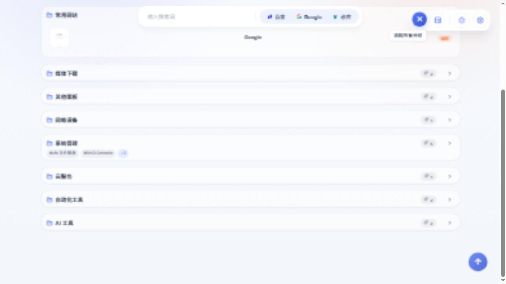

# Local Navigation Page

[]()
[]()
[]()
[]()
[]()
[]()

纯 HTML、CSS 和 JavaScript 实现的本地/内网导航页：零依赖、零构建，数据存浏览器本地，支持 Docker 或任意静态服务器部署。字体与图标已本地化，**断网或纯内网环境界面完整可用**（仅网站缩略图 / favicon 需要外网）。



## 功能一览

**链接与分组**

- 紧凑网格磁贴布局：图标 + 名称 + 标签，悬浮显示完整名称与地址
- 一个链接可配置多个地址（内网 / 隧道 / 公网），卡片角标一键切换并记住选择
- **智能选路**（独有能力）：首选地址探测离线时，自动切换到在线且延迟最低的地址
- 在线状态探测：可配置频率（30s–5min 或关闭），状态点呼吸动画 + 悬停延迟毫秒数
- 分组三种排序：名称（拼音）/ 链接数量 / 手动（管理分组弹窗上下移），卡片、标签栏、设置三处同序
- 分组图标按名称自动匹配（服务器 / 影片 / 机器人 / 路由器…），磁贴首字母多彩着色
- 删除链接 8 秒内可点击提示撤销

**搜索与效率**

- 多引擎搜索：百度 / Google / 必应开箱即用，可自定义引擎与图标
- **前缀直达**：搜索框输入 `/g 关键词`、`/bing 词` 直接用指定引擎（匹配引擎名 / URL 主机名 / 自定义前缀）
- `Ctrl/Cmd + K` 键盘启动器：多关键词过滤（`nas 管理` 命中「NAS 管理」），最近使用优先
- `/` 快速聚焦搜索框；分组内方向键在磁贴间导航，Enter 打开
- `Shift + 点击` 以独立小窗（1100×780）打开链接，适合临时查看管理页

**外观与个性化**

- 日 / 夜模式，刷新不闪白
- **主题色选择器**：8 组预设主色一键切换全站配色（日/夜自动适配明度）
- 自定义 CSS 与自定义 JS：设置中输入即生效，随备份导出
- 三档显示密度（均衡 / 紧凑 / 舒展）、玻璃质感、页面位置布局

**数据安全**

- 浏览器内编辑全部数据（localStorage），导入 / 导出完整备份（带版本元数据）
- **导入前自动备份**：覆盖式导入确认后自动下载当前配置，误操作可回滚
- 书签导入（Netscape HTML / CSV）：文件夹自动映射为分组，重复自动跳过
- 备份来自更新版本时给出兼容性警告

**工程与部署**

- PWA：可安装、Service Worker 离线缓存（数据网络优先、静态资源缓存优先 + 后台更新）
- 打印样式：Ctrl+P 输出平面清单
- 私密导航页保护：robots.txt 禁止索引 + 页面 noindex；nginx 全站安全响应头
- 数据层 20 个单元测试（`npm test`，零依赖沙箱执行器）+ CI 三道关（测试 / 校验 / Docker 构建）

## 快速开始

内置零依赖服务器（需要 Node.js 18+）：

```bash
git clone https://github.com/LceAn/LocalNavigationPage.git
cd LocalNavigationPage
npm run serve          # 默认 8080，可带端口参数：npm run serve -- 3000
```

或 Python 静态服务器：

```bash
git clone https://github.com/LceAn/LocalNavigationPage.git
cd LocalNavigationPage/HTML
python3 -m http.server 8080
```

访问 `http://127.0.0.1:8080`。不建议直接双击 `index.html`，浏览器可能阻止读取 `data/links.json`。

Docker Compose：

```bash
git clone https://github.com/LceAn/LocalNavigationPage.git
cd LocalNavigationPage
docker compose up -d --build
```

默认访问 `http://127.0.0.1:8080`。Compose 将 `HTML/data` 挂载到容器；首次启动缺少 `links.json` 时，入口脚本会从安全示例创建。

## 链接数据

`HTML/data/links.json.default` 是 Docker 初始化模板，`HTML/data/links.json` 是静态部署需要的公开示例。两者在仓库中必须保持一致，防止误把私人管理地址提交到 Git。

页面中的编辑结果保存在浏览器 `localStorage`。私有地址建议通过页面导入/导出管理，或放在仓库外的 Docker 数据卷中。提交前运行验证命令确认示例没有被替换；本地开发若临时使用私有 `links.json`，可用 `LNP_ALLOW_PRIVATE_LINKS=1 npm run validate` 跳过该项检查（切勿提交私有数据）。

一个链接可以使用单个 `url`，也可以使用多个带标签和优先级的 `urls`：

```json
{
  "ID": 2,
  "name": "NAS 管理",
  "category": "存储",
  "urls": [
    { "address": "http://192.168.1.100:5000", "label": "本地", "priority": 1 },
    { "address": "https://your-host.example.com", "label": "远程", "priority": 2 }
  ]
}
```

只允许 `http` 和 `https` 示例地址；数据在规范化与渲染两层都强制协议白名单，`javascript:` 等危险地址会被直接丢弃。

## 自定义

**主题色**：设置 → 外观 → 主题色，8 组预设一键切换（无需改代码）。

**进阶改色**：编辑 `HTML/CSS/tokens.css` 的 `:root`（浅色）与 `.dark-mode`（深色）令牌。颜色使用 `oklch()`，派生色由 `color-mix()` 自动生成，改主色即可联动：

```css
:root {
    --primary-color: oklch(62% 0.19 268);   /* 主色（靛蓝） */
    --accent-color:  oklch(73% 0.17 45);    /* 强调色（橙）  */
    --tertiary-color: oklch(72% 0.13 180);  /* 第三色（青）  */
    /* 派生色与文字/背景通常无需改动 */
}
```

**搜索引擎**：设置 → 搜索引擎，可新增、编辑或删除；URL 模板用 `%s` 表示关键词，可填「搜索前缀」（如 `b`）实现 `/b 关键词` 直达。

**自定义 CSS / JS**：设置 → 外观底部文本框，输入即生效，随备份导出。

## 开发验证

需要 Node.js 18+，无需安装第三方包：

```bash
npm test               # 数据层单元测试（20 例）
npm run validate       # 链接 JSON、资源引用、脚本语法、跨脚本重声明检查
docker build --tag local-navigation-page:test .
```

验证范围：两份链接 JSON 的格式 / ID / 协议、公开示例与模板一致、HTML 资源存在且不越界、全部 JS 与 Shell 语法、经典脚本顶层重声明（防全局词法环境冲突）、Docker 镜像可构建。

## 目录

- `HTML/index.html`：页面入口
- `HTML/js/`（按加载顺序）：
  - `storage.js` — 设置容器、v1→v2 迁移、跨标签页同步
  - `links-data.js` — 链接模型、URL 协议白名单、多地址选择、状态探测
  - `home-render.js` — 首页分组渲染、磁贴构建、视图标签
  - `settings-links.js` — 设置面板链接列表、筛选、拖拽排序
  - `display.js` — 时钟 / 日期 / 天气
  - `search-engines.js` — 搜索引擎管理与执行
  - `launcher.js` — Ctrl+K 键盘启动器
  - `main.js` — 交互编排与初始化
  - `darkMode.js` — 主题状态
- `HTML/CSS/`：页面样式（`tokens.css` 为设计令牌）
- `HTML/data/`：公开示例与 Docker 默认配置
- `HTML/sw.js`：Service Worker 离线缓存
- `scripts/`：`validate.mjs`（校验）、`serve.mjs`（零依赖服务器）、`test/`（单元测试）
- `docker/`：Nginx 配置与数据初始化脚本
- `docs/`：更新日志、路线图与设计文档

## 许可

本项目使用 [Apache License 2.0](LICENSE)。

<!-- repo-readme-standard:v1 -->
## 仓库维护信息

- 项目类型：静态网页工具
- 当前状态：维护中
- 可见性：public
- 维护节奏：按月检查浏览器兼容性、公开示例和 Docker 构建
- 相关仓库：与 `Navigation_Index` 都属于导航领域，但数据模型和产品边界不同，不建议直接合并
- 维护边界：公开前必须复核链接数据；归档、删除或历史重写需单独确认

## 特性路线图

- [x] 导入 / 导出配置（含导入前自动备份）
- [x] 自定义搜索引擎（含 `/前缀` 直达）
- [x] 网站缩略图 / favicon 预览（内网自动回退首字母磁贴）
- [x] 快捷键（`Ctrl+K` 启动器、`Ctrl+,` 设置、`/` 聚焦搜索、方向键导航）
- [x] 排序（链接拖拽 + 分组名称 / 数量 / 手动三种模式）
- [x] 主题定制（8 组预设主题色 + 自定义 CSS / JS）
- [x] 内网多地址与智能选路
- [ ] 多语言切换（zh-CN / en-US）
- [ ] 图标库扩展（Iconify 集成）

---

**最后更新：** 2026-10-29
**当前版本：** 1.8.1

---

## 文档

- [docs/CHANGELOG.md](docs/CHANGELOG.md) — 更新日志
- [docs/FEATURES_ROADMAP.md](docs/FEATURES_ROADMAP.md) — 功能规划与路线图
- [SECURITY.md](SECURITY.md) — 安全策略
