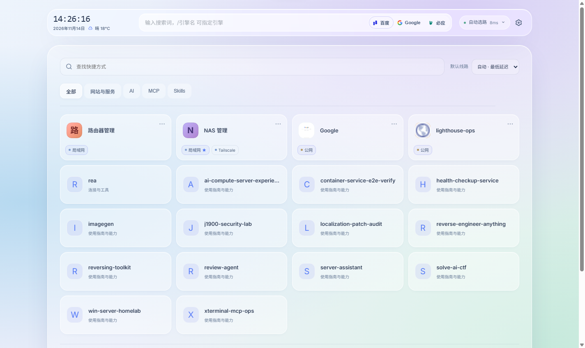

# Local Navigation Page

[]()
[]()
[]()
[]()
[]()
[]()

纯 HTML、CSS 和 JavaScript 实现的本地 / 内网导航页，零依赖、零构建。默认是搜索首页，底部箭头在原页面展开快捷抽屉；网站、AI、MCP 与 Skills 用统一磁贴收纳。Node.js / Docker 部署支持服务器共享配置与多端同步，纯静态部署也能运行（配置保存在浏览器）。

字体与图标已本地化，**断网或纯内网环境界面完整可用**（仅网站缩略图 / favicon 需要外网）。

| 搜索首页 | 快捷抽屉 |
|---|---|
|  |  |

## 1.18 → 1.27 更新亮点

### 搜索首页与快捷抽屉

- 首页只保留时间、日期、天气与紧凑搜索框，底部轻量箭头在原页面展开快捷抽屉
- 展开时时间、搜索框与设置平滑收拢到同一条吸顶栏，收起时反向复原
- 抽屉按 **全部 / 网站与服务 / AI / MCP / Skills** 类型筛选，支持关键词搜索
- 分类集中在「设置 → 链接与分组」管理，不再占用首页空间

### 服务器共享配置

- Node.js / Docker 模式新增 `/api/config`：链接、分类、分类图标、排序、网络环境等共享保存
- 每次编辑先写本机草稿，再自动保存到服务器；断线保留草稿，恢复连接后自动重试
- 其他设备打开抽屉、切回窗口或定时同步时拉取最新版本
- 版本冲突使用三方合并；不同链接 / 不同字段的修改自动合并，同一字段冲突保留草稿并提示
- 主题、当前访问线路、最近访问、当前网络环境按设备保存

### 网络环境与智能选路

- 右上角网络气泡展示当前访问环境，可切换家里、公司、Tailscale 与公网等配置
- 环境名称、优先线路、检测地址在「设置 → 首页内容 → 网络环境」管理并共享保存
- 填写检测地址后，气泡列表显示当前电脑对各环境的可达性与延迟
- 抽屉内「默认线路」支持自动最低延迟 / 局域网优先 / 内网穿透优先 / 公网优先
- 单链接可固定默认 URL 或跟随全局，星标指示卡片默认打开地址

### 多地址与状态

- 每个 URL 独立显示局域网 / Tailscale / 公网气泡，点击气泡直接访问对应线路
- 所有 HTTP(S) URL 由当前浏览器独立检测，可配置频率（30s–5min 或关闭），共用六个并发名额并去重
- 可读响应显示可达、认证或 HTTP 错误；跨域不透明响应显示「有响应 · 未确认」
- 自动模式按当前电脑的 HTTP 往返延迟选择最快的可响应 URL，并保留手动选择优先级

### MCP / Skills 资源详情

- MCP 服务与技能收纳在统一快捷方式中，通过类型标签筛选，在设置中统一编辑和删除
- 点击资源卡片打开同页详情窗口；MCP 详情实时发现工具、查看输入 / 输出 Schema 与客户端接入配置，窗口打开期间每 60 秒刷新，也可手动重新检测
- MCP 检测支持 Streamable HTTP、SSE 与 STDIO，兼容 2026-07-28 按请求发现协议与 2025/2024 握手协议
- Skills 详情展示指南、依赖、声明工具、兼容性、版本、许可证与配套文件
- `npm run catalog` 自动扫描并脱敏生成目录；详情检测由导航服务器完成，纯静态部署下仅展示卡片

### 外观与交互

- 液态玻璃样式统一覆盖首页、卡片、设置和编辑面板，浅色 / 深色自动适配
- 右上角常驻路线状态与设置；悬停、键盘聚焦或触屏长按展开快捷方式、布局与昼夜模式工具
- 布局菜单即时预览首页位置与快捷网格密度
- 设置标题与搜索同栏，侧栏、统计和操作栏采用紧凑布局，手机端保持标题与搜索同排
- 天气氛围：首个城市的雨雪粒子、雾气与降温冷色边缘随天气变化淡入淡出；15 分钟天气缓存，页面隐藏时暂停绘制，系统减弱动态效果与全局动画开关均生效

## 核心功能

### 入口与抽屉

- 紧凑网格磁贴展示图标、名称和地址气泡，悬浮显示完整名称与地址
- 默认搜索首页，底部无文字小图标在原页面展开全部入口
- 抽屉支持类型筛选与多关键词搜索（`nas 管理` 可命中「NAS 管理」）
- 分组支持自定义图标和手动排序，集中在设置中管理
- 分组名称原位修改，创建与排序即时保存；扫描目录项的修改以覆盖记录保存
- 删除入口 8 秒内可点击提示撤销

### 多地址与选路

- 一个入口可配置多个地址，每个 URL 独立显示线路与可达性状态
- 线路按主机名自动识别：私网段 / Tailscale 域名与 CGNAT / `.home.arpa` / IPv6 ULA / 标签补注
- 智能选路：自动模式逐个服务选择延迟最低的可响应 URL；单项可固定默认地址或跟随全局
- 内网 / 隧道 / 公网状态统一使用路线色：内网绿、隧道紫、公网蓝

### 搜索与效率

- 多引擎搜索：百度 / Google / 必应开箱即用，可自定义引擎与图标
- **前缀直达**：搜索框输入 `/g 关键词`、`/bing 词` 直接用指定引擎（匹配引擎名 / URL 主机名 / 自定义前缀）
- `Ctrl/Cmd + K` 键盘启动器：多关键词过滤，最近使用优先
- `/` 快速聚焦搜索框；抽屉内方向键在磁贴间导航，Enter 打开
- `Shift + 点击` 以独立小窗（1100×780）打开链接，适合临时查看管理页

### 外观与个性化

- 日 / 夜模式，刷新不闪白
- **主题色选择器**：8 组预设主色一键切换全站配色（日 / 夜自动适配明度）
- 自定义 CSS 与自定义 JS：设置中输入即生效，随备份导出
- 三档显示密度（均衡 / 紧凑 / 舒展）、玻璃质感、页面位置布局
- PWA：可安装、Service Worker 离线缓存（数据网络优先、静态资源缓存优先 + 后台更新）
- 打印样式：`Ctrl+P` 输出平面清单

### 数据与安全

- 本机草稿 + 服务器共享双层保存：离线可继续编辑，重连自动同步
- 导入 / 导出完整备份（带版本元数据）；覆盖式导入前自动下载当前配置，误操作可回滚
- 书签导入（Netscape HTML / CSV）：文件夹自动映射为分组，重复自动跳过
- 备份来自更新版本时给出兼容性警告
- 私有导航页保护：`robots.txt` 禁止索引 + 页面 `noindex`；Node / Nginx 部署带安全响应头
- 协议白名单在数据规范化与渲染两层强制执行，`javascript:` 等危险地址会被丢弃

### 工程与部署

- 零依赖、零构建；Node.js 服务器内置 REST API 与共享配置接口
- `npm run mcp` 启动 MCP Server，AI 助手可直接管理导航链接（详见 [docs/API.md](docs/API.md)）
- 数据层 / 服务器 / 界面逻辑共 **142 个单元测试**（15 个测试文件，`npm test`）
- CI 三道关：单元测试 / 配置校验 / Docker 构建
- Docker 镜像基于 Node.js 22；持久化目录 `/data`

## 快速开始

### Node.js 服务（推荐）

需要 Node.js 18+（推荐 20 / 22，Docker 镜像基于 22）：

```bash
git clone https://github.com/LceAn/LocalNavigationPage.git
cd LocalNavigationPage
npm run serve          # 默认 8080，可带端口参数：npm run serve -- 3000
```

首次启动会在 `HTML/data/` 创建缺失的 `links.json`（从公开模板复制）。可通过 `LNP_DATA_DIR` 指定其他持久化目录：

```bash
LNP_DATA_DIR=/srv/nav-data npm run serve
```

### Docker Compose

```bash
git clone https://github.com/LceAn/LocalNavigationPage.git
cd LocalNavigationPage
docker compose up -d --build
```

默认访问 `http://127.0.0.1:8080`。Compose 将 `./HTML/data` 挂载到容器 `/data`；首次启动缺少 `links.json` 时，服务会从公开模板创建。

### 纯静态部署

```bash
cd LocalNavigationPage/HTML
python3 -m http.server 8080
```

访问 `http://127.0.0.1:8080`。静态模式使用浏览器本机配置，**不包含服务器共享同步，也不提供 MCP / Skills 详情检测**；不建议直接双击 `index.html`，浏览器可能阻止读取 `data/links.json`。

### 一键扫描本机服务

```bash
npm run scan                          # 扫描并生成 links-local.json
npm run scan -- --probe               # HTTP 标题探测：服务名更准确（并行，约 20s）
npm run scan -- --merge               # 直接合并进 links.json（只增不改不删）
npm run scan -- --host 192.168.1.100  # 生成局域网 IP 地址（手机也能访问）
npm run scan -- --list                # 只预览表格，不写文件
```

扫描自动发现监听端口 → 按端口号 / 进程名智能分类（Web / 开发 / 媒体 / 监控…）→ 生成可导入的 JSON。

- SSH、MySQL、Redis 这类非 HTTP 端口不会生成链接（浏览器打不开），扫描结束会汇总提示
- 输出文件 `HTML/data/links-local.json` 已在 `.gitignore` / `.dockerignore` 中，不会进仓库或镜像
- 导入是**覆盖式**的：设置 → 数据 → 导入会替换现有全部链接（导入前会自动备份当前配置）

### 收录 MCP / Skills

```bash
npm run catalog        # 读取 ~/.workbuddy/mcp.json + ~/.workbuddy/skills
```

生成 `HTML/data/catalog.json`（已 gitignore / dockerignore），抽屉中统一展示目录。支持 `--mcp <path>` / `--skills <dir>` / `--out <path>`；env 与 headers 只保留键名，args 中的 token 自动打码。

MCP 详情需要 Node.js 服务的检测能力。服务器配置方式、环境变量与容器挂载见 [部署说明](docs/DEPLOY.md#资源详情与服务器配置1240)。

## 部署与同步

- 运行结构、HTTPS、Tailscale 访问、目录权限与升级步骤：见 [docs/DEPLOY.md](docs/DEPLOY.md)
- 共享配置接口、版本冲突与目录检测：见 [docs/API.md](docs/API.md)
- 数据字段与设置键：见 [docs/SCHEMA.md](docs/SCHEMA.md)

服务器模式下，链接与分类是共享数据；主题、访问线路、最近访问、当前网络环境按设备保存。断线时保留本机草稿，重连自动重试；同一字段冲突会在界面提示，先导出备份再刷新合并。

## 链接数据

`HTML/data/links.json.default` 是 Docker / Node 初始化模板，`HTML/data/links.json` 是静态部署需要的公开示例。两者在仓库中必须保持一致，防止误把私人管理地址提交到 Git。

一个入口可以使用单个 `url`，也可以使用多个带标签和优先级的 `urls`：

```json
{
  "ID": 2,
  "name": "NAS 管理",
  "kind": "site",
  "category": "存储",
  "urls": [
    { "address": "http://192.168.1.100:5000", "label": "本地", "priority": 1 },
    { "address": "https://your-host.example.com", "label": "远程", "priority": 2 }
  ]
}
```

- `kind`：`site` / `ai` / `mcp` / `skill`，决定抽屉中的类型标签
- `catalogKey`：扫描目录项的关联键；覆盖项作为普通链接保存
- `copyValue`：MCP / Skill 的命令或路径；此类条目可以没有 `urls`

只允许 `http` 和 `https` 示例地址；数据在规范化与渲染两层都强制协议白名单。

## 与主流导航页对比

| 能力 | Homepage | Homarr | Dashy | Sun-Panel | Flare | Flame | **本项目** |
|---|---|---|---|---|---|---|---|
| 多地址链接（内网 / 隧道 / 公网） | – | – | – | 手动切换 | – | – | ✅ **自动智能选路** |
| 服务器共享配置 / 多端同步 | – | – | – | – | – | – | ✅ 草稿 + 三方合并 |
| MCP / Skills 资源详情 | – | – | – | – | – | – | ✅ 工具发现 + 指南 |
| 状态探测（延迟毫秒） | ✅ | ✅ | ✅ | – | – | – | ✅ 可配频率 |
| 主题色预设 | CSS | ✅ | 15 主题 | CSS / JS | – | 15 主题 | ✅ 8 预设 + 自定义 CSS / JS |
| 离线可用（纯静态） | – | – | – | – | ✅ | – | ✅ 字体全本地化 |
| 前缀搜索 `/g 词` | – | – | ✅ | – | – | ✅ | ✅ |
| 导入前自动备份 | – | ✅ | ✓ | – | ✅ | – | ✅ |
| 键盘启动器 | ✅ | ⌘K | ✅ | – | – | ✅ | ✅ 多关键词 |
| 书签 HTML 导入 / 导出 | – | – | – | – | ✅ | – | ✅ 双向 |
| 零依赖零构建 | – | – | – | – | ✅ | – | ✅ 单文件可跑 |

> 需要后端的能力（容器监控、系统资源、多账号）不在本项目范围内——那些请配合 Portainer / Glances 使用，导航页只放入口。

## 自定义

**主题色**：设置 → 外观 → 主题色，8 组预设一键切换（无需改代码）。

**进阶改色**：编辑 `HTML/CSS/tokens.css` 的 `:root`（浅色）与 `.dark-mode`（深色）令牌。颜色使用 `oklch()`，派生色由 `color-mix()` 自动生成，改主色即可联动：

```css
:root {
    --primary-color: oklch(62% 0.19 268);   /* 主色（靛蓝） */
    --accent-color:  oklch(73% 0.17 45);    /* 强调色（橙）  */
    --tertiary-color: oklch(72% 0.13 180);  /* 第三色（青）  */
    /* 派生色与文字/背景通常无需改动 */
}
```

**搜索引擎**：设置 → 搜索引擎，可新增、编辑或删除；URL 模板用 `%s` 表示关键词，可填「搜索前缀」（如 `b`）实现 `/b 关键词` 直达。

**自定义 CSS / JS**：设置 → 外观底部文本框，输入即生效，随备份导出。

## 开发验证

需要 Node.js 18+，无需安装第三方包：

```bash
npm test               # 142 个单元测试：数据层 / 服务器 / 选路 / 界面逻辑
npm run validate       # 链接 JSON、资源引用、脚本语法、跨脚本重声明检查
npm run scan           # 本机端口扫描（生成 gitignore 的 links-local.json）
npm run catalog        # 生成 MCP / Skills 目录（gitignore）
docker build --tag local-navigation-page:test .
```

验证范围：两份链接 JSON 的格式 / ID / 协议、公开示例与模板一致、HTML 资源存在且不越界、全部 JS 与 Shell 语法、经典脚本顶层重声明（防全局词法环境冲突）、Docker 镜像可构建。

## 目录

- `HTML/index.html`：页面入口
- `HTML/js/`（按加载顺序）：
  - `storage.js` — 设置容器、v1→v2 迁移、跨标签页同步、i18n 基础
  - `links-data.js` — 链接模型、协议白名单、多地址选择、状态探测、智能选路
  - `network-environments.js` — 网络环境配置、当前环境与可达性检测
  - `navigation.js` — 搜索首页与同页快捷抽屉
  - `server-sync.js` — 服务器配置自动保存与版本合并
  - `catalog.js` — MCP / Skills 目录数据适配
  - `resource-details.js` — MCP / Skills 详情窗口与工具发现
  - `home-render.js` — 磁贴构建、视图标签、右键菜单
  - `settings-links.js` — 设置中的链接列表、分组侧栏、筛选与拖拽排序
  - `weather-effects.js` — 天气氛围（雨雪 / 雾 / 降温）
  - `display.js` — 时钟 / 日期 / 天气
  - `search-engines.js` — 搜索引擎管理与执行
  - `launcher.js` — Ctrl+K 键盘启动器
  - `main.js` — 交互编排与初始化
  - `toolbar.js` — 右上角工具栏展开与提示
  - `darkMode.js` — 主题状态
- `HTML/CSS/`：页面样式；`navigation.css`、`resource-details.css`、`toolbar.css`、`weather-effects.css` 对应新模块，`tokens.css` 为设计令牌
- `HTML/data/`：公开示例与 Docker / Node 默认配置
- `HTML/sw.js`：Service Worker 离线缓存
- `scripts/`：`validate.mjs`（校验）、`serve.mjs`（Node 服务器 + REST API + 共享配置）、`config-store.mjs`（配置版本与原子写入）、`catalog-service.mjs`（目录 / 详情检测）、`mcp-client.mjs`（MCP 协议客户端）、`mcp-server.mjs`（MCP Server）、`scan-local.mjs`（本机端口扫描）、`scan-catalog.mjs`（MCP / Skills 目录）、`test/`（单元测试）
- `docker/`：旧版静态 Nginx 部署配置与初始化脚本
- `docs/`：部署、API、数据格式、更新日志与设计文档

## 许可

本项目使用 [Apache License 2.0](LICENSE)。

<!-- repo-readme-standard:v1 -->
## 仓库维护信息

- 项目类型：本地 / 内网导航与资源目录
- 当前状态：维护中
- 可见性：public
- 维护节奏：按月检查浏览器兼容性、公开示例和 Docker 构建
- 相关仓库：与 `Navigation_Index` 都属于导航领域，但数据模型和产品边界不同，不建议直接合并
- 维护边界：公开前必须复核链接数据；归档、删除或历史重写需单独确认

## 特性路线图

- [x] 导入 / 导出配置（含导入前自动备份）
- [x] 自定义搜索引擎（含 `/前缀` 直达）
- [x] 网站缩略图 / favicon 预览（内网自动回退首字母磁贴）
- [x] 快捷键（`Ctrl+K` 启动器、`Ctrl+,` 设置、`/` 聚焦搜索、方向键导航）
- [x] 排序（链接拖拽 + 分组名称 / 数量 / 手动三种模式）
- [x] 主题定制（8 组预设主题色 + 自定义 CSS / JS）
- [x] 内网多地址与智能选路
- [x] 服务器共享配置与多端同步（草稿 / 三方合并 / 冲突提示）
- [x] 网络环境气泡与延迟选路
- [x] MCP / Skills 目录与资源详情
- [x] 搜索首页 + 同页快捷抽屉 + 液态玻璃
- [x] 天气氛围（雨雪 / 雾 / 降温）
- [x] 多语言切换（zh-CN / en-US；起步覆盖主要文案）

---

**最后更新：** 2026-11-14
**当前版本：** 1.27.0

---

## 文档

- [docs/CHANGELOG.md](docs/CHANGELOG.md) — 更新日志
- [docs/FEATURES_ROADMAP.md](docs/FEATURES_ROADMAP.md) — 功能规划与路线图
- [SECURITY.md](SECURITY.md) — 安全策略
- [docs/API.md](docs/API.md) — REST API 与 MCP 接口文档
- [docs/DEPLOY.md](docs/DEPLOY.md) — 服务器、HTTPS 与 Tailscale 部署
